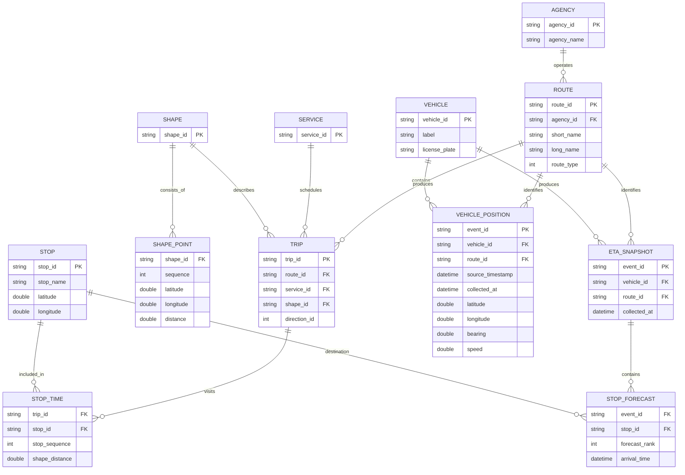

## Источники и способ получения

Получены статические и realtime-данные об общественном транспорте Санкт-Петербурга из официального источника СПб ГКУ «Организатор перевозок».

Использовались два источника:

1. Static GTFS — ZIP-архив с CSV-справочниками:
   `https://transport.orgp.spb.ru/Portal/transport/internalapi/gtfs/feed.zip`.
2. GTFS Realtime — protobuf-потоки:
   - `vehicle` — координаты и состояние транспорта;
   - `vehicletrips` — прогнозы прибытия транспорта к остановкам.

Для сбора был поднят Docker-контур из Kafka и собственного collector-сервиса. Позиции запрашивались каждые 10 секунд, ETA — каждые 30 секунд пакетами по 100 транспортных средств.

Исходные protobuf-ответы сохраняются без изменений в Base64, а извлечённые данные валидируются и публикуются в Kafka в JSON-формате.

## Объём данных

### Static GTFS

Архив, актуальный на 8 октября 2026 года, содержал:

| Набор | Количество строк |
|---|---:|
| Перевозчики (`agency`) | 1 |
| Маршруты (`routes`) | 546 |
| Остановки (`stops`) | 8 761 |
| Рейсы (`trips`) | 128 992 |
| Точки геометрии маршрутов (`shapes`) | 892 238 |
| Связи рейсов с остановками (`stop_times`) | 3 541 519 |
| Календари (`calendar`) | 1 009 |
| Исключения календаря (`calendar_dates`) | 316 906 |

Размер ZIP-архива — 35 473 936 байт, около 33,8 МБ.

### GTFS Realtime

Выборка собиралась около трёх минут — с 17:59:27 до 18:02:28 по московскому времени.

Сбор данных проводился и в течение более длительных интервалов: в проекте уже есть отдельный 200-минутный прогон. Для этого отчёта из него не рассчитывались итоговые показатели — ниже приведена небольшая конкретная выборка, которую проще проверить и использовать как пример формата и объёма поступающих данных.

| Данные | Результат |
|---|---:|
| Сообщения с позициями | 57 445 |
| Уникальные наблюдения позиций | 49 709 |
| Уникальные транспортные средства | 3 414 |
| Уникальные маршруты | 493 |
| ETA snapshot'ы | 16 879 |
| Уникальные ETA snapshot'ы | 3 520 |
| Отдельные прогнозы прибытия | 200 322 |
| Raw HTTP-ответы | 186 |
| Размер raw protobuf payload | 8 154 715 байт |

Все 186 запросов вернулись с HTTP 200, ошибок декодирования protobuf не было.

## Примеры формата

### Позиция транспортного средства

```json
{
  "schema_version": "1",
  "event_id": "4ee5e6e5261e91fd6adbd90834333977101b1c8b8dc69d56ece714afa2a1f041",
  "collected_at": "2026-10-08T14:59:06.149172Z",
  "source_timestamp": "2026-10-08T14:55:59Z",
  "vehicle_id": "23946",
  "route_id": "1853",
  "latitude": 59.863040924072266,
  "longitude": 30.459699630737305,
  "bearing": 117.0,
  "speed": 0.0,
  "label": "6627",
  "license_plate": "Р787ОВ198"
}
```

### Прогноз прибытия

```json
{
  "schema_version": "1",
  "event_id": "02045a1c0b95f259c06a5317869e80f1850c33885aa203b05c0529b69ec91ef8",
  "collected_at": "2026-10-08T14:59:36.023049Z",
  "vehicle_id": "1113",
  "route_id": "233",
  "forecasts": [
    {
      "forecast_rank": 0,
      "stop_id": "36495",
      "arrival_time": "2026-10-08T14:56:10Z"
    },
    {
      "forecast_rank": 1,
      "stop_id": "3032",
      "arrival_time": "2026-10-08T14:58:31Z"
    },
    {
      "forecast_rank": 2,
      "stop_id": "1651",
      "arrival_time": "2026-10-08T15:02:52Z"
    }
  ]
}
```

Raw-ответ также содержит endpoint, время запроса, HTTP-статус, тип содержимого, SHA-256 и исходный protobuf в Base64.

## Модель данных



## Проблемы и ограничения

- За три минуты collector отбросил 52 из 57 497 сущностей позиций — около 0,09 %. Они не соответствовали обязательному внутреннему контракту. Точная причина для каждой сущности сейчас отдельно не журналируется.
- Источник иногда отдаёт не совсем свежие координаты. Среднее отставание `source_timestamp` от времени получения составило 57 секунд, максимальное — 1 237 секунд, то есть около 20 минут 37 секунд.
- Из 16 879 ETA snapshot'ов 4 327, или 25,6 %, содержали пустой список прогнозов.
- Polling создаёт повторные сообщения: 57 445 сообщений соответствуют 49 709 уникальным событиям. Для дедупликации используется детерминированный `event_id`.
- Realtime API не предоставляет надёжный `trip_id`, поэтому положение транспорта нельзя напрямую связать с конкретным рейсом из static GTFS. Связь с геометрией маршрута приходится определять отдельно по `route_id` и координатам.
- Приведённая в отчёте выборка короткая и отражает только один временной интервал. Даже с учётом имеющегося 200-минутного прогона для статистически значимых выводов необходимо собирать данные несколько суток, включая часы пик, выходные и ночное время.
